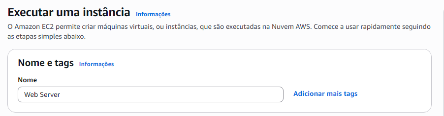
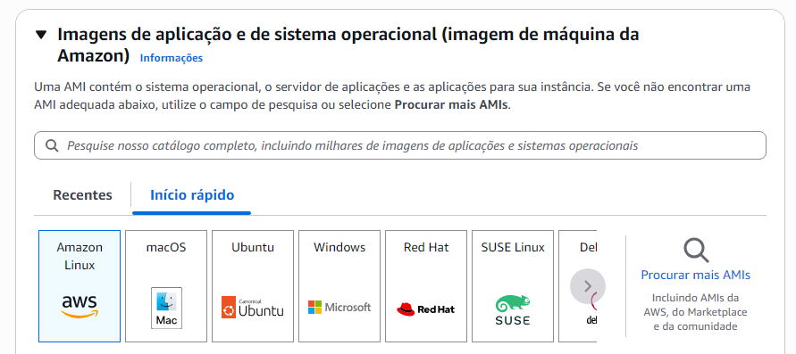
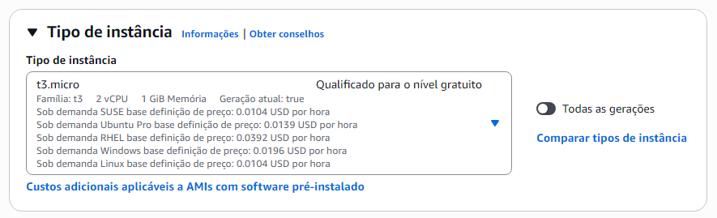
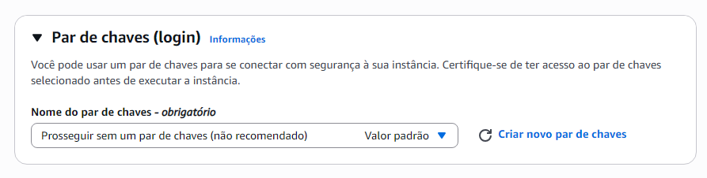
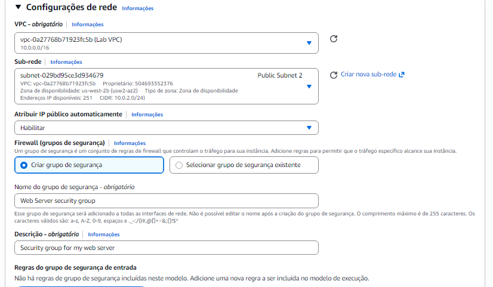
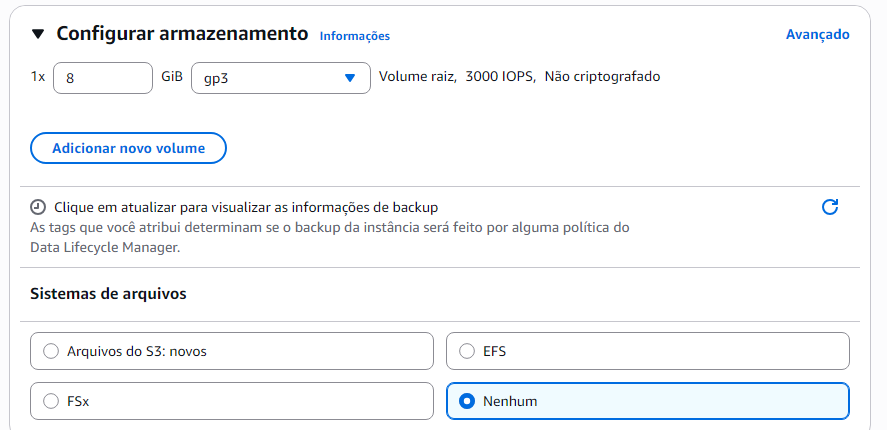
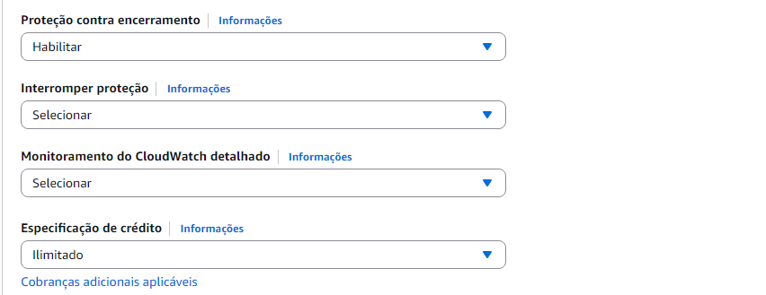
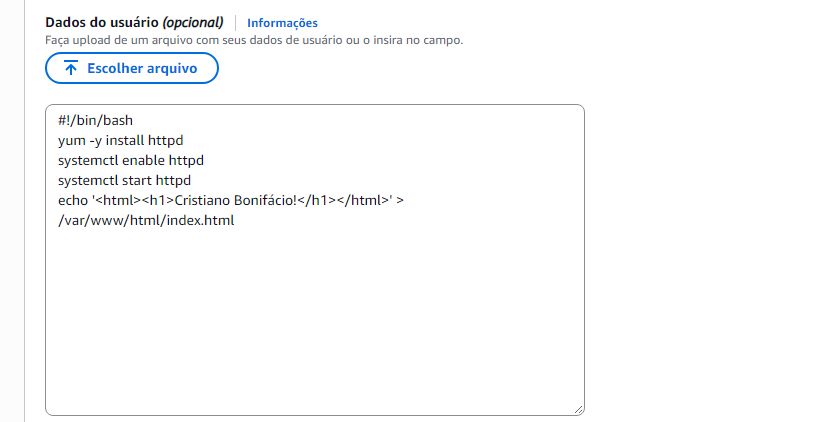
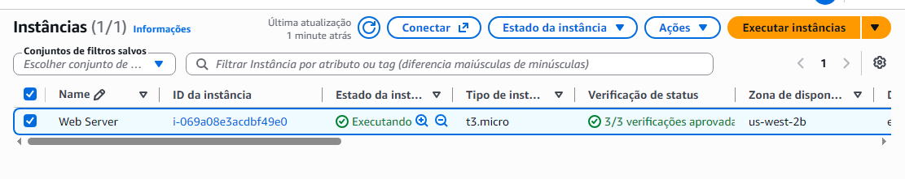

# ☁️ Laboratório AWS — Introdução ao Amazon EC2


Projeto prático desenvolvido durante a formação **Computação em Nuvem — AWS re/Start**, da [Escola da Nuvem](https://escoladanuvem.org/).

## 📸 Evidências do laboratório

### 01 — Executar uma instância



### 02 — Selecionar uma AMI



### 03 — Selecionar o tipo de instância



### 04 — Configurar o par de chaves



### 05 — Configurar a rede



### 06 — Configurar o armazenamento



### 07 — Configurar detalhes avançados



### 7.1 - Configurar detalhes avançados



### 08 — Instância criada



---

## 🎯 Objetivos

- Criar uma instância Amazon EC2.
- Configurar uma AMI e um tipo de instância.
- Configurar rede e grupos de segurança.
- Automatizar a instalação de um servidor web.
- Monitorar a instância.
- Liberar o tráfego HTTP na porta 80.
- Redimensionar a instância e o volume EBS.
- Testar a proteção contra encerramento.

## 🛠️ Serviços e tecnologias

| Serviço | Finalidade |
|---|---|
| Amazon EC2 | Servidor virtual na nuvem |
| Amazon Linux 2023 | Sistema operacional |
| Amazon VPC | Rede virtual |
| Security Groups | Controle de tráfego |
| Amazon EBS | Armazenamento |
| Amazon CloudWatch | Monitoramento |
| Apache HTTP Server | Servidor web |
| Bash / User Data | Automação |

## 🚀 Passo a passo

### 1. Acessar o console AWS

- Iniciar o laboratório na plataforma educacional.
- Aguardar o ambiente ficar disponível.
- Abrir o AWS Management Console.
- Acessar o serviço Amazon EC2.
- Manter a região definida pelo laboratório.

### 2. Criar a instância EC2

**Nome:** `Web Server`

**AMI:** `Amazon Linux 2023`

**Tipo inicial:** `t3.micro`

**Par de chaves:** prosseguir sem par de chaves, conforme as instruções do laboratório.

**Rede:** `Lab VPC`

**Grupo de segurança:** `Web Server security group`

**Armazenamento inicial:** `8 GiB`

### 3. Configurar proteção e User Data

Ativar a proteção contra encerramento e inserir o seguinte script no campo User Data:

```bash
#!/bin/bash

yum -y install httpd
systemctl enable httpd
systemctl start httpd

echo '<html><h1>Hello From Your Web Server!</h1></html>' > /var/www/html/index.html
```

O script instala o Apache, configura sua inicialização automática, inicia o serviço e cria uma página HTML.

Executar a instância e aguardar o estado `Running` e as verificações de status aprovadas.

### 4. Monitorar a instância

- Consultar a guia **Status checks**.
- Verificar as condições de acessibilidade do sistema e da instância.
- Acessar a guia **Monitoring** para visualizar as métricas do CloudWatch.
- Explorar o recurso de captura de tela para diagnóstico.

### 5. Liberar acesso HTTP

No console EC2, acessar **Security Groups** e editar as regras de entrada de `Web Server security group`.

Adicionar a seguinte regra:

| Parâmetro | Valor |
|---|---|
| Tipo | HTTP |
| Protocolo | TCP |
| Porta | 80 |
| Origem | `0.0.0.0/0` |

Salvar as regras e acessar o IPv4 público da instância no navegador.

**Resultado esperado:**

`Hello From Your Web Server!`

> Em ambientes de produção, restrinja a origem do tráfego sempre que possível.

### 6. Redimensionar a instância

Interromper a instância antes de alterar seu tipo.

| Recurso | Antes | Depois |
|---|---|---|
| Tipo de instância | `t3.micro` | `t3.small` |
| Volume EBS | `8 GiB` | `10 GiB` |

Alterar o tipo da instância pelo menu de ações do EC2. Em seguida, acessar **Elastic Block Store → Volumes**, selecionar o volume e utilizar **Modify volume** para aumentar o tamanho para 10 GiB.

Depois das alterações, iniciar novamente a instância.

### 7. Testar a proteção contra encerramento

1. Tentar encerrar a instância com a proteção ativada.
2. Confirmar que a operação é bloqueada.
3. Acessar as configurações da instância.
4. Desativar a proteção contra encerramento.
5. Salvar a alteração.
6. Encerrar a instância.

### 8. Finalizar o laboratório

Encerrar o laboratório pela plataforma educacional e confirmar a finalização.

## 💡 Aprendizados

- Provisionamento de servidores na AWS.
- Automação com User Data.
- Configuração de redes e grupos de segurança.
- Monitoramento com CloudWatch.
- Redimensionamento de computação e armazenamento.
- Proteção e gerenciamento do ciclo de vida de instâncias.

## 🧠 Conclusão

O laboratório proporcionou experiência prática com criação, configuração, monitoramento, redimensionamento e encerramento de instâncias Amazon EC2.

A atividade também demonstrou a importância da automação, do controle de acesso à rede e dos mecanismos de proteção no gerenciamento de recursos em nuvem.

## 🎓 Formação

- **Instituição:** Escola da Nuvem
- **Curso:** Computação em Nuvem
- **Programa:** AWS re/Start
- **Laboratório:** Introdução ao Amazon EC2

🌐 [Escola da Nuvem](https://escoladanuvem.org/)
